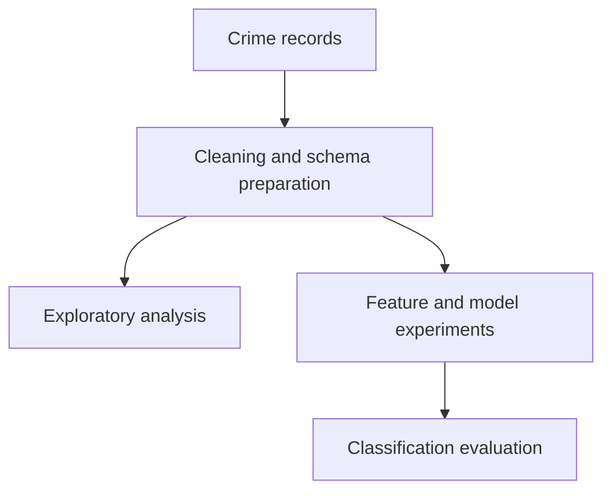

# Chicago Crime Analysis
**Apache Spark · Data cleaning · Exploratory analysis · MLlib**

A group coursework project analysing Chicago crime records through a distributed workflow: data cleaning, exploratory analysis, feature experiments and Random Forest incident classification. The repository includes the submitted report and a Databricks notebook archive.

[Group report](reports/group-21-report.pdf) · [Notebook guide](docs/NOTEBOOKS.md) · [Databricks export](databricks/chicago_clean.dbc) · [Demonstration guide](docs/DEMO.md)

## Work included

- Cleaning and preparing crime records for analysis.
- Exploring the dataset in a dedicated EDA notebook.
- Comparing numeric, text and combined feature approaches.
- Building Spark MLlib pipelines with Random Forest and cross-validation.
- Documenting the group work in a report and Databricks export.

## Workflow



The task classifies recorded incident categories. It is not demonstrated forecasting of future crime.

## Explore the work

| Stage | Artifact | What to inspect |
|---|---|---|
| Cleaning | [cleaning.ipynb](cleaning.ipynb) | Original preparation workflow |
| Exploration | [eda.ipynb](eda.ipynb) | Saved exploratory analysis |
| Feature comparison | [feature_analysis.ipynb](feature_analysis.ipynb) | Numeric, text and combined configurations |
| Modelling | [modelling.ipynb](modelling.ipynb) | Maintained model entry point |
| Implementation | [crime_pipeline.py](crime_pipeline.py) | Training and evaluation |
| Submission | [Group report](reports/group-21-report.pdf) | Original project narrative |
| Original experiments | [archive/](archive/) | Historical modelling outputs |

## Reading the evidence

The report and original notebooks document the submitted coursework. The maintained pipeline subsequently addresses preprocessing leakage, feature alignment and class-metric calculation. Historical scores are not presented as results of a fresh run of the corrected implementation.

**Start with the report**, then follow the [notebook guide](docs/NOTEBOOKS.md). This is group coursework; a detailed individual contribution split has not been established from the upload.

## Repository guide

| Location | Contents |
|---|---|
| Root notebooks | Cleaning, EDA and maintained modelling entry points |
| [crime_pipeline.py](crime_pipeline.py) | Shared Spark modelling implementation |
| [reports/](reports/) | Submitted group report |
| [databricks/](databricks/) | Original DBC export |
| [archive/](archive/) | Earlier feature/modelling notebooks |
| [docs/](docs/) | Walkthrough, inventory and technical notes |

<details>
<summary>Setup and future work</summary>

```bash
python -m pip install -r requirements.txt
python crime_pipeline.py /path/to/crimes.csv --mode numeric
```

Requires a compatible Java/PySpark environment and the source CSV. Text modes are retrospective experiments because descriptions may encode the target category.

Future work: restore the exact dataset extract, document the cleaning-to-model handoff and rerun the corrected pipeline.

[Implementation notes](docs/REPAIRS.md) · [Initial review](docs/REPRODUCIBILITY.md)
</details>
